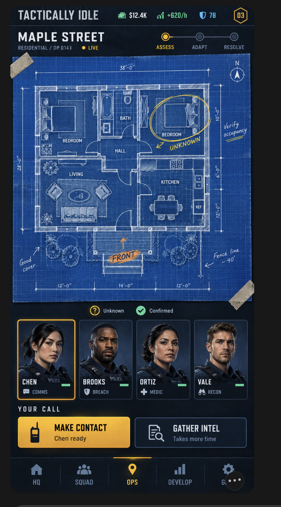

# Tactically Idle game and first playable plan

**Status:** Target design revised 2026-10-22. The NPC patrol economy and dedicated Store are planned, not implemented. Work still to do and owner decisions live only in [docs/backlog.md](docs/backlog.md).

**Created:** October 1, 2026. **Updated:** October 22, 2026, America/New_York. **Prepared by:** Codex from the user's game concept, approved image, and public Reddit discussions. **Audience:** The owner and future design, art, and engineering contributors.

## Game overview

Tactically Idle is a portrait mobile department-management game with an idle economy and short branching tactical operations. The player hires officers, develops capabilities, prepares squads and makes decisions on a generated blueprint. Experience, stress, resource use and public trust return to the department.

The current visual direction is a working department at blue hour: deep blue surfaces, warm interior light, ivory text, amber actions, mint funding, expressive portraits and substantial controls. It supersedes earlier aesthetic restrictions where they conflict. The blueprint remains interactive and driven by operation data. Repeat-play and recovery questions are tracked with playtests in [docs/backlog.md](docs/backlog.md).

The owner removed tapping from the target design on 2026-10-22. A separately staffed NPC Patrol division replaces it and replaces SWAT's routine revenue patrol. SWAT keeps signing costs and wages; “free” meant available between calls. The detailed economy, progression, Store navigation and adversarial controls are in [Patrol workforce and Store redesign](docs/patrol-work.md). Call writing and branching outcomes remain outside this redesign.

## Standing decisions and source constraints

### Decided by the user

1. The game is named **Tactically Idle** and is designed for mobile.
2. It combines idle progression, a development tree, and playable tactical operations.
3. Players hire and fire officers from a pool. Officers have traits, capabilities, and expected pay.
4. Players unlock training and equipment and manage inventory.
5. Operations use building blueprints and successive choices affected by the squad and equipment.
6. Stress creates recovery needs, particularly after adverse outcomes.
7. The attached detailed blue-paper operations mockup is the accepted visual reference. [cite: user requests and approval in this chat]
8. Location, room size, officer shooting proficiency, composure, and presented options must materially affect operations. Every generated blueprint needs corresponding game information. [cite: user's follow-up on meaningful blueprints]
9. The department can own up to **four** unique persistent squads and send one or more squads to an operation. [cite: user's squad-count instruction, raised from three to four on 2026-10-02]
10. Structures are varied and generated (non-rectangular footprints, at most two floors), with varied occupants, threats, placements and difficulty per run, and an auto-equip option. Specification: [procedural locations](docs/procedural-locations.md). [cite: user's 2026-10-02 instruction]

### Constraints

- Preserve the blue grid paper, architectural drawing, marker annotations, illustrated squad cards, dark framing, and amber actions of the approved image. [cite: approved reference]
- Make the operation visibly spatial; a generic text questionnaire with a decorative floorplan does not satisfy the request. [cite: original operation concept and rejection of the text-heavy mockup]
- Include recruitment, dismissal, recurring payroll, traits, training, equipment, inventory, branching operations, and recovery in the complete first playable loop. [cite: original feature request]
- Each consequential choice must have an observable dependency on scenario state, people, or equipment. [cite: original equipment/skill-dependent outcome request]
- Geometry and semantic location data must be the common source for the drawn blueprint, available actions, and outcome calculations. An independently generated image with inferred rules added afterward is insufficient. [cite: user's meaningful-blueprint requirement; implementation consequence]
- Keep four persistent squad slots with no duplicate personnel or physical equipment assignments. Current v13 calls deploy one squad, as derived from their choices.

### Product decisions

The browser game uses portrait presentation, local saves, fictional people and grounded, non-graphic calls. Calls warn about their topics on the card, a launch advisory names the game's themes, and players can avoid three themes (self-harm, child at risk, domestic violence); this is being built, and the store rating stays the owner's Mature target. The design is [content warnings](docs/content-rating.md). Release scope, commercial choices and device targets belong to the [backlog owner decisions](docs/backlog.md#owner-decisions). Balance values are tunable.

## Intended players and observable outcomes

The initial audience is mobile idle players who enjoy planning and visible progression, and management players interested in a squad whose composition matters. Tactical-game enthusiasts are a secondary audience; their tolerance for abstract choices must be tested.

1. A player can leave and return to understandable, useful progress without payroll unexpectedly consuming their savings.
2. Changing an officer, certification, or item changes at least one available approach or outcome contributor.
3. A player can understand how a decision affected the operation and use that knowledge on the next assignment.
4. Stress makes a reserve roster useful while leaving department management and recovery available.
5. The live operations screen preserves the approved image's visual identity at actual phone size.
6. Changing a location's size, room connections, or relevant position changes at least one explainable action cost, requirement, or resolution contributor.
7. The player can maintain four distinct squads with separate assignments, condition and resource use. Current v13 calls deploy one squad.

## Approved visual reference

The screenshot records approval. Its outer capture frame and overflow-menu overlay are not product requirements. Its decorative dimensions, illustrated labels, balances, and character roles are examples rather than a validated simulation or final economy.

### Visual language

- **Operation map:** Saturated blue graph paper with fine grid lines, restrained grain and folds, white drafting ink, and irregular marker annotations. Tape corners and wear stay secondary.
- **Architecture:** Exterior wall thickness, connected interior rooms, door openings and swing arcs, paired window lines, furniture, plumbing fixtures, entrances, and porches. Each setting gets a plausible layout rather than repeated rectangular grids.
- **Annotations:** Amber means unresolved information or a proposed choice; mint means confirmed information. Pair both with symbols and labels. New information visibly changes the relevant room or annotation.
- **Characters:** Illustrated portraits, distinct faces, readable surnames, role symbols, and readiness bars. Selecting an officer highlights their relevant capability.
- **Chrome:** Dark navy/charcoal, condensed display typography, readable supporting type, compact resource indicators, and amber primary actions. Textures do not sit over essential small text.
- **Feedback:** Short marker strokes, changed map states, portrait reactions, and progress changes communicate consequences. Respect reduced-motion settings. Sound and haptics are optional enhancements after the core loop.

Do not render the entire interface as one bitmap. Keep portraits and paper textures as art assets; render interactive labels, states, hit targets, and buttons independently. The drawing layer and the operation data share room identifiers so visual information cannot drift from scenario logic.

### Screen composition

At the 390 × 844 portrait design target, live situations and choices precede expanded maps and supporting detail. The full interactive blueprint is immediately accessible. A persistent pressure cue reserves space rather than covering controls. On shorter screens, allow deliberate scrolling instead of shrinking every label and portrait.

Use five labeled destinations on management screens. Live calls retain focused navigation:

| Destination | Primary job | Visual treatment |
| --- | --- | --- |
| HQ | Review credited progress, patrol funding, SWAT readiness and the next action. | Compact illustrated station with visible activity and net funding. |
| Calls | Prepare, command, and review operations. | Distinct scene-led call cards, readable situations and choices, accessible blueprint. |
| Team | Manage SWAT, Patrol personnel and Command Staff. | Portrait roster with separate tactical condition and patrol output/cost views. |
| Build | Choose facilities, capabilities and authorized staffing capacity. | Illustrated objects with prerequisites and progression. |
| Store | Buy equipment, usable boosts and available real-money offers. | Persistent rightmost tab, clear currencies, ownership and confirmed purchases. |

The live portrait strip displays the deployed squad, and the blueprint shows its position and physical moves. Decision buttons retain the illustrated icon, short action title, compact eligibility/consequence line, amber selection treatment, and dark secondary alternative. Expanded detail is available on selection before confirmation.

Essential actions must work by touch without hover. The touch-target design minimum is 44 logical pixels. Provide room selection/zoom and a text alternative to spatial information. Use the marker lettering for brief annotations, not all body text.

## Core play loop and pacing

1. **Return:** Receive a shift report showing elapsed time, net funding, completed training, recovered officers, and notable shortages.
2. **Manage:** Choose a recruit, course, facility upgrade, or supply purchase. Show consequences before spending.
3. **Prepare:** Read the mission's known and unknown facts. Choose one available squad for a v13 call and reserve equipment. Squads hold four officers.
4. **Assess:** Choose an initial priority and receive a state change.
5. **Adapt:** Respond to new information, resource pressure, or a complication.
6. **Resolve:** Commit to a resolution, change the objective, or hand over responsibly.
7. **Debrief:** See objective results, civilian and officer outcomes, supplies used, stress, and the reasons behind them.
8. **Develop:** Apply rewards and rotate or train the next squad.

Session design targets: a quick management visit around one minute, and an operation session around three to five minutes. These are usability hypotheses. Today closing the app between decisions pauses the operation. Under the proposed [call pressure](docs/call-pressure.md) design, real time on an open decision with a threat becomes game minutes, at home or away, unless the player sets the timer to Off. One open decision can land at most its own threat, so an interruption never ends a call.

## Department economy and offline simulation

Begin with funding and public trust. Funding pays wages, purchases and development; each development can instead be granted free at a milestone (department level, calls resolved or trust). Trust is a standing that affects opportunities, not a spendable currency. There are no development points (removed 2026-10-20).

Funding comes from a base department allocation and a separate NPC patrol workforce. Routine service funding reflects staffed coverage, not arrests, tickets or casualties. NPC hires have onboarding costs, wages and operating costs. Their grades advance through eligible service hours, not money earned; department-level staffing ceilings cannot be purchased past with NPC income. SWAT's routine patrol income and tapping are retired in this target design. SWAT standby, rest, training and deliberate instructor details remain. See [the revised budget and boost contract](docs/patrol-work.md).

The revised proposed starting budget preserves $620/hour net: $600 allocation plus four patrol staff at $210 gross each, less $180 patrol payroll, $60 patrol operations, $380 SWAT payroll and $200 fixed costs. These are balance inputs awaiting simulation. Funding is credited automatically; opening a report or watching an animation never grants it again.

Rules:

- Display gross funding, wages, operating cost, net rate, and the projected change before a hire or upgrade.
- Resolve offline production with the same rates as equivalent unattended online production. Active choices can change assignments, but merely leaving the screen open earns no extra multiplier.
- Funding has a 24-hour accrual cap. Income and recurring costs share the same accrual window. Queued training and recovery can finish beyond that cap.
- Process completed jobs and resource limits in time order; do not multiply the final hourly rate across the entire absence.
- The first playable prevents optional commitments that would create a recurring deficit. It does not include an unmanaged debt system.
- A failed operation does not remove baseline funding. Emergency basic equipment and safe routine assignments provide a recovery path.
- Procurement automation respects a spending ceiling and cannot drive funds below zero.
- Offline progress is awarded once. Reopening or moving the clock backward must not duplicate rewards.

## Officers, recruitment, and career

Each officer has skills, certifications, contextual traits, pay expectations, experience, stress, and a current assignment. Use explicit ratings for shooting proficiency, composure, communication, awareness, medical response, and coordination. Ratings use a 0 to 100 display scale; balance values are tunable.

| Rating | What it affects in the game | What it does not imply |
| --- | --- | --- |
| Shooting proficiency | Execution quality and error risk in applicable abstract field-resolution checks. | More successful violence is not automatically a better mission outcome. |
| Composure | Maintaining decision/execution quality under pressure and susceptibility to additional strain. | Immunity to stress, injury, or mandatory recovery. |
| Communication | Contact, comprehension, and negotiation-related options. | Automatic access without required certification or equipment. |
| Awareness | Identifying uncertain or conflicting information and observing relevant changes. | Revealing every hidden fact. |
| Medical response | Stabilization and injury-consequence checks. | Reversing every injury. |
| Coordination | Shared actions, task handovers, and communication between squads. | A flat multiplier for adding more officers. |

Composure is an officer capability; stress is current condition. Calculate an effective task contribution from both, without charging the same stress effect twice under different names. Traits apply only when their documented condition is present. The player can inspect the base rating, condition adjustment, and relevant gear/trait contributions.

Certifications open actions or qualify an officer for a role. Traits modify specific circumstances. Examples include Steady (less strain under escalating uncertainty), Observant (better detection of inconsistent information), Mentor (supports a trainee), and Impatient (an advantage under urgent conditions with a cost in extended waiting). None is a universal rarity multiplier.

Recruitment presents a small pool with visible wages, signing cost, traits, skills, and certifications. Shortlisting preserves a candidate while the player compares. Refresh rules and targeting a missing role must be clear; avoid paid random officer pulls in the first release.

Hiring requires capacity and an affordable projected budget. Dismissal previews severance, returns assigned equipment, releases future assignments, and cannot happen during deployment. Dismissing and rehiring an officer must not erase condition or generate free signing rewards.

Training reserves the officer and course slot until completion. Department unlocks make courses available; completion grants the officer's skill or certification. Unlocking a course is not itself instant officer qualification. Team familiarity is tracked as unused call capability in [docs/backlog.md](docs/backlog.md) (`familiarity-priorities`).

## Persistent squads and joint operations

The department has four stable squad slots with unique IDs, player-selected names, rosters, a leader and saved loadout preferences. Each squad holds four officers. An incomplete squad shows its missing personnel or qualifications.

An officer belongs to one squad at a time. Reassignment cannot bypass stress, injury or training. Deployed squads cannot take another assignment, and item reservations prevent duplicate use.

Current v13 calls put one squad to work. Their `squadRange` is derived from their choices. Joint operations and simultaneous tactical incidents are tracked only in [docs/backlog.md](docs/backlog.md).

## Development tree

The 16 Develop nodes use five branches: Personnel, Field Capability, Intelligence, Logistics, and Wellbeing. Major nodes open options; supporting upgrades improve efficiency or capacity.

Example chain: unlock negotiation training → train a second negotiator → assign that officer with appropriate equipment → access contact-based options while the first negotiator recovers.

Develop shows prerequisites, cost and the capability gained. Its unlocks are non-exclusive.

Expansion scope is tracked in the [backlog owner decisions](docs/backlog.md#owner-decisions).

## Equipment and inventory

Separate reusable equipment, consumable supplies, and installed department infrastructure. Inventory distinguishes owned, available, reserved, and under-maintenance quantities.

Equipment enables approaches or reduces particular risks. Better equipment may improve reliability, capacity, or handling, but one expensive item should not dominate every mission. Use abstract game attributes rather than a detailed real-world equipment simulator.

Deployment reserves a loadout atomically so simultaneous squads cannot use the same physical item. Consume supplies only when used. Return reusable items at debrief, update condition visibly, and release reservations if preparation is canceled. Maintenance must be forecastable rather than an unannounced mid-mission item loss.

Saved loadout preferences and budget-limited restocking reduce repeated inventory work.

## Tactical operation model

### Scenario structure

Each operation is an authored state graph attached to a building layout. State includes current stage, known facts, unresolved facts, time pressure, objective progress, civilian status, team strain, supplies, and prior decisions. Branches can reconverge while preserving these differences.

### Meaningful blueprint generation

Generate or author structured location data first, validate it, then render the approved visual style from that data. Each playable location is delivered with its geometry, room types, dimensions, connections, relevant objects, scenario hooks, and reproducible seed/version. The image is a view of that information, not the authoritative location record.

Room size, shape, connectedness, and relative position must influence named game systems. Examples: a larger area increases an abstract assessment task's workload; a remote room adds traversal time according to the location graph; limited usable space constrains how many participants contribute to a task; a separated room changes communication requirements; a room's use changes plausible information and objectives. These are game abstractions, not real-world tactical formulas. Where a visual object is decorative, mark it as such in content data so it cannot imply an unsupported mechanic.

Keep actual location facts separate from the player's current knowledge. The engine may know a room's properties while the briefing supplies an outdated or partial sketch. Unknown labels, corrected dimensions, and marker updates must reflect that distinction consistently. A visual reveal occurs only when an action changes the knowledge state.

The game uses authored layouts and procedural buildings with validated generated variations. A variation can change dimensions, valid room connections, occupancy facts, or task placements within author-defined rules. Reject disconnected rooms, inconsistent door/wall geometry, overlapping spaces, impossible role requirements, and unreachable outcomes. Do not permit freeform image generation to invent a playable map. The detailed [location and operation data contract](docs/operation-model.md) defines the content package and its checks.

Generated families include bungalows, two-story houses, duplexes, apartments, corner stores with apartments, offices, bars or restaurants, warehouses and motel rows. These are fictional layouts built for legibility and plausible architecture.

### Choices and resolution

Offer two or three meaningful actions at a stage. Show required skills/certifications/items, the intended benefit, material risks, and what remains uncertain. Keep locked actions visible with a reason when it helps the player understand progression.

Calculate contributions from the acting officer roles, shooting/composure and other relevant ratings, equipment, preparation, applicable traits, familiarity, stress, location geometry, task workload, and scenario difficulty. Joint actions also include actual support and coordination constraints. Use diminishing returns so adding raw skill or squads never guarantees every outcome. The Scenario Lab exposes contributors and tunable balance values.

Resolve actions into favorable, mixed, or adverse developments. A poor check can consume time, leave a fact unresolved, or increase strain instead of instantly failing the whole operation. Do not make overall success depend on passing every independent check in sequence.

Use separate final results for objective completion, civilian safety, officer condition, preserved information, resources, and trust. Explain material causes in the debrief. The visible risk estimate must be labeled as conditional on known information.

Time pressure stays in game minutes. In the proposed [call pressure](docs/call-pressure.md) design, real time a player spends on an open decision adds game minutes to it at the timer setting's rate (Off, Relaxed by default, or Standard), capped at the open threat's minutes. The threat on screen and its countdown are one clock, and the previews read the added minutes before the player commits, so nothing is hidden. The added minutes are recorded with the decision so replays match.

Save the scenario seed, state, selected action, and resolved result together. Resuming cannot reroll the same decision or apply the same reward twice.

## Stress, recovery, and failure

Track stress per officer. A squad summary is derived from its members and must not overwrite individual condition. Stress increases according to each officer's exposure, role, traits, and incident severity, not only the mission's success label.

Stress bands are Ready 0 to 29, Strained 30 to 59, Overloaded 60 to 79 and Mandatory recovery 80 to 100. Penalties and recovery rates are tunable. Mild strain affects relevant tasks; overloaded officers are restricted from high-risk assignments; mandatory recovery prevents deployment.

Keep recovery eligibility explicit: show when an officer is expected to be deployable and what improves recovery. Medical injuries are a separate, less frequent source of absence. The first playable excludes permanent officer death.

Recovery and reserve staffing support roster rotation. Every operation is live; department management and recovery remain available between calls. A paid skip is never required after an adverse result.

## Current playable scope

The browser game has four squad slots, a 100-officer catalog, 16 Develop nodes, recruitment, payroll, training, gear, recovery and local campaign saves. Command Staff v1 is built on HQ.

Barricade, armed incident, hostage and protected rescue are the current v13 calls. Each takes one squad on a generated building. Choices make physical moves, rescue sightlines use geometry, and force requires a carried firearm and a qualified officer. Content has one current version; old saves are rejected.

All remaining work lives in [docs/backlog.md](docs/backlog.md).

## Implementation approach

The browser architecture has a presentation layer, deterministic simulation, authored content and local saves. Architecture boundaries are enforced by `src/architecture/` and rendered to [docs/architecture.md](docs/architecture.md).

Core records: Department, Officer, Squad, Employment, Assignment, Course, DevelopmentNode, ItemDefinition, InventoryStack, LoadoutReservation, LocationDefinition, ScenarioDefinition, KnowledgeState, OperationRun, DecisionResolution, Debrief, and SaveEnvelope. Each record has a stable identifier; state changes apply as transactions. The linked operation data contract specifies room geometry, squad roles, action bindings, and resolution provenance.

Build the map from room geometry and shared object identifiers. Apply the paper texture and ink treatment over the geometry; keep marker annotations and touch targets in separately addressable layers. Author portraits and equipment imagery as replaceable assets. Validate paths and text at final display size.

Mobile engine and device targets are tracked in the [backlog owner decisions](docs/backlog.md#owner-decisions); device validation is in the [backlog](docs/backlog.md#player-experience).

The strongest risk of a painted whole-screen asset is unreadable text and nonfunctional interactions. The alternative is a fully dynamic renderer with less visual fidelity. **Accepted with controls:** painted textures and portraits alongside interactive geometry and text. Device verification is tracked in [docs/backlog.md](docs/backlog.md).

## Acceptance criteria and review responsibility

These criteria describe the behavior under review, not a second work list or a claim that every check has passed. Outstanding validation lives in [docs/backlog.md](docs/backlog.md).

1. **Reference fidelity:** Capture the actual operations screen at 390 × 844 and compare it beside the approved reference. It contains blue textured grid paper; connected architectural rooms with fixtures, windows, and door arcs; marker-style uncertainty; four illustrated officer cards; stage progress; amber decisions; and the five specified destinations. No generic text-card replacement satisfies this check.
2. **Small-screen access:** At 320 × 568, essential actions remain reachable without horizontal page scrolling; map zoom/selection and the room information alternative work; touch targets meet the chosen minimum.
3. **Capability dependency:** Replace the qualified communicator with an unqualified officer, then remove the required communications equipment in a separate run. Each relevant option changes availability or its stated contributors for the correct reason.
4. **Branch consequence:** Two runs with the same starting state and different decisions produce differing state, annotations, or debrief contributors. Generated v13 situations require different priorities; no tested option is uniformly superior across the sampled situations.
5. **Hiring and dismissal:** Hiring deducts the displayed cost and changes recurring wages once. Dismissal applies the previewed severance, returns gear, and removes the officer once. Unaffordable or deployed-officer actions show a reason and do not mutate state.
6. **Training and tree:** An unavailable course becomes available after its node unlock. Certification is granted only on course completion; the assigned officer is unavailable for overlapping deployment.
7. **Inventory integrity:** Equipment reserved for one squad is unavailable to another. Cancellation releases it. Debrief charges only used supplies and returns reusable items exactly once.
8. **Offline equivalence:** For identical starting state and no active decisions, compare a four-hour unattended online simulation and offline settlement. Funding, inventory, course completion, and recovery agree. Repeat at the cap and beyond it, including a job completing partway through the interval.
9. **No hidden offline debt:** At or beyond the cap, payroll does not continue independently of income. Optional purchases/restocking cannot make balances negative.
10. **Recovery:** A mandatory-recovery officer cannot deploy. Advancing the simulation according to the displayed recovery rules restores eligibility. A team-wide setback leaves department management and a funded recovery path available.
11. **Interruption integrity:** Close/resume after preparation, each decision, and debrief. The committed outcome, seed, costs, reservations, and rewards survive without duplication or reroll. Backward clock movement does not create a second grant. Once call pressure is built, time away during an open decision counts once, never past the cap, and a backward clock never reduces or repeats it.
12. **Understandable outcome:** After playing, participants explain a roster/equipment effect and a consequence using information available in the game. Record misunderstandings and revise the design; this exploratory round does not establish statistical market demand.
13. **Routine automation:** After unlocking a preset and a restock rule, repeat a deployment without manually reallocating each item. The rule respects its budget ceiling and reports shortages.
14. **Research-grounded pacing review:** Playtest notes explicitly record guide dependence, forced inactivity, repetitive manual tasks, and visual comprehension. Content expansion waits until each material issue has a fix or an owner-accepted tradeoff.
15. **Geometry affects play:** With the same squad and scenario seed, change only one applicable room dimension or graph connection in a valid test location. Both the drawing and a specified task workload, time, capacity, requirement, or probability contributor change. A recolor or label change alone does not pass.
16. **Rating relevance:** Hold location, equipment, and random sample constant. Change only shooting proficiency for an applicable execution check, then only composure for a pressure check. The corresponding calculation trace changes in the specified direction; unrelated checks do not gain those modifiers automatically.
17. **Four unique squads:** Create squads A, B, C and D; a fifth is refused with a visible reason. Attempt duplicate officer and item assignments; they are refused. Rename or rebuild an available squad and confirm its identity persists without resetting officer condition.
18. **Call squad limits:** Current v13 calls accept one squad, matching the range derived from their choices. Deployment respects that range and counts participants and items once. Joint-operation work lives in [docs/backlog.md](docs/backlog.md).
19. **Generation consistency:** For each generated test case, run structural and scenario validation before display. Identical seed/content version regenerates the same location. Invalid cases return a controlled authoring error or a known-valid fallback. Every interactive room and displayed action resolves to existing content IDs.
20. **Presentation matches the reference:** Select a squad and a room. The portraits, marker highlight, action actor/target, concise requirement line, and optional detail panel agree. Confirming an action animates the matching knowledge/task change and records its result; changing selection alone has no consequence.

## Non-goals for the first playable

- Real-time direct unit movement or detailed combat simulation: would obscure the test of branching command decisions.
- Multiplayer, PvP, clans, and leaderboards: add service and balance work before the core loop is proven.
- Live events, attendance streaks, battle passes, and notifications that pull a player back into a call: can create obligations that interfere with testing voluntary return play.
- Paid officer gacha, forced ads, or paid success boosts: would distort initial pacing and roster validation.
- Unconstrained procedural buildings, image-first playable maps, or freeform generated scenario prose: the initial approach is authored layouts plus validated, data-driven variations.
- Full prestige resets, permanent death and complex interpersonal drama are outside the current scope.
- App-store release is outside the browser scope. Release decisions live in [docs/backlog.md](docs/backlog.md#owner-decisions).

## Risks and the strongest alternative

**Strongest objection:** The game may appeal to neither audience: too demanding for an idle player and too abstract for a tactical player. The strongest alternative is a department-only idle game with automated operations. The current recommendation is **needs validation**: test the branching loop before funding the broader content plan.

Other failure stories and controls:

- Players always select the same squad and action. Test contrasting situations and preserve tradeoffs rather than adding numerical difficulty alone.
- The development tree becomes a disguised single correct sequence. Use readable capability effects, non-exclusive early nodes, and supported alternatives; test without guides.
- Recovery stops the session. Keep reserve depth and funded recovery routes available; measure whether players still choose to leave frustrated.
- The shipped art becomes plain panels and text. Make the reference comparison an explicit milestone gate and budget for production art.
- Beautiful room drawings imply facts the simulation does not know. Bind visual states to the same room and object data used by branches.
- Squad count obscures actual participation. Current calls use one squad, and their derived limits reflect the squads their choices put to work.
- Scenario authoring expands combinatorially. Reuse authored decision modules, reconverge branches without erasing consequences, and validate every terminal route.
- Save errors destroy long-term attachment. Treat transaction and interruption checks as critical-path work.

## Owner decisions

The [Owner decisions section of docs/backlog.md](docs/backlog.md#owner-decisions) is the only list of unresolved product and implementation decisions.

## Research basis and verification record

The separate [Reddit research summary](docs/research/reddit-idle-games.md) records sources, recurring recommendations, dissent, and limits. It supports the design questions and controls above, not retention forecasts or a popularity ranking.

This document records the current scope and the design rules behind it. It does not claim native-device validation or completed playtests. Architecture rules are enforced in `src/architecture/` and rendered to [docs/architecture.md](docs/architecture.md). Remaining validation and release decisions live in [docs/backlog.md](docs/backlog.md).
