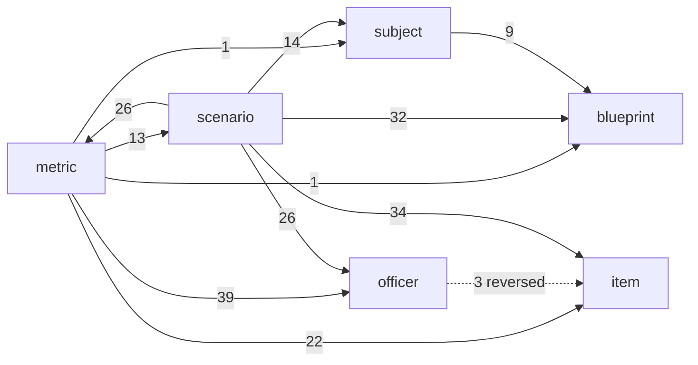

# Architecture

Generated from `src/architecture/` by its tests. Do not edit by hand: change the manifest, then run
`npx vitest run src/architecture -u`. A test fails when the code and this page disagree.

## Layers

A module may import its own layer and the layers it lists. Type-only imports do not count. Imports are read from each file's
syntax tree (`src/dev/import-graph.ts`, with the parser Vite ships), and a dynamic `import()` must name its module literally.

| Layer | Modules | Lines | May import | Owns |
| --- | --- | --- | --- | --- |
| kernel | 10 | 2632 | nothing | Shared records, ids, seeded randomness, geometry and the tuning registry. No game rules. |
| world | 50 | 8307 | kernel | Blueprints: authored and procedural buildings, rooms, openings, furniture, routes and sightlines. |
| catalog | 27 | 4723 | kernel, world | Authored data: officers, personas, items, courses, unlocks, call templates and call trees. |
| scenario | 10 | 3149 | kernel, world, catalog | Turns a drawn call into a playable definition: cast, placement on the blueprint, compiled tree. |
| engine | 68 | 15481 | kernel, world, catalog, scenario | Game rules and state: department, economy, operations, resolution, outcomes, saves. |
| qa | 39 | 6136 | kernel, world, catalog, scenario, engine | Content gates, balance measurement, fixtures and test support. Never loaded by the game. |
| ui | 177 | 22498 | kernel, world, catalog, scenario, engine | Player screens, the blueprint renderer, portraits and the store that dispatches commands. |
| lab | 104 | 18234 | kernel, world, catalog, scenario, engine, qa, ui | The dev-only Scenario Lab and dev sheets. Reads everything, never ships. |
| shell | 3 | 398 | kernel, world, catalog, engine, ui, lab | Entry points that choose which app to mount. |

## Systems

| System | Modules | Lines | Job |
| --- | --- | --- | --- |
| blueprint | 81 | 13947 | Where things are: buildings, rooms, doors and windows, furniture, routes, cover and sightlines. |
| subject | 7 | 1360 | Who is on scene: subjects, hostages, victims, bystanders and animals, their holds, weapons, temper (agitation and rapport) and positions. |
| officer | 21 | 2616 | Who the player sends: ratings, traits, stress, injuries, certifications, careers and squads. |
| item | 7 | 1394 | What they carry: the item catalog, ratings and capabilities, force risk, inventory and wear. |
| scenario | 68 | 15616 | What happens: call trees, placement on the blueprint, choices, chance per choice, branches and clocks, and the call-time logistics (loadouts, resupply, outside support) that read the items. |
| metric | 31 | 5519 | What it meant: outcome scoring, harm, debriefs, department reputation, money and progression, and the Command Staff who run the department. |
| platform | 273 | 41106 | Everything that serves the systems above: records, randomness, saves, the store, screens and tooling. |

## System dependency chain

Runtime imports between systems (count of module edges). Platform is left out.

Solid edges follow the intended chain (the scenario reads the blueprint, people, officers and items; metrics read what happened). Dotted edges run against it:

- `officer -> item`: issue kit: a hire brings items into the pool, priced into the signing

## What moves the odds

Each input a system feeds into a choice's chance, and whether the engine actually reads it.
`wiring.test.ts` perturbs the input on every opening choice of every call tree and checks the favorable chance moves (or, for a gap, that it still does not).

| System | Input | Measured | Floor | Evidence |
| --- | --- | --- | --- | --- |
| officer | Officer ratings (every rating of squad A at 95 instead of 60) | 27 of 27 | 100% | `aptitude` weights each rating per task (src/sim/resolution.ts); the task-weight test checks each choice reads only its own ratings |
| officer | Officer strain (squad A at stress 90) | 27 of 27 | 100% | `conditionFraction` takes strain off each rating (src/sim/officer.ts) |
| officer | Certificates (squad A holds none) | 6 of 27 | 9% | A choice with a certBonus credits the first officer taking part who holds it (src/sim/resolution.ts): a crisis negotiator on the talk, an advanced first aider on care, a surveillance specialist on a watch (owner 2026-10-20: the certificates finally matter). Measured 2026-10-20: 10 of 115 sampled choices, all hostage; the legacy trees carry none yet. |
| item | Carried equipment (squad A deploys with nothing) | 3 of 9 | 20% | A choice gets the gear its physical act asks for (src/gen/incident/action-gear.ts): a shield when the team goes in, the hailer for a voice through the walls, observation aids for a watch from outside, plus any gear the choice authors. Phone calls, texts, waits and walk-outs ask nothing of carried gear, and radios are standard issue, so neither responds. Measured 2026-10-18: 6 of 30 opening choices. |
| blueprint | Door and window states (every opening locked) | 9 of 27 | 27% | A choice that moves the team (TreeTeam: into a room, to a vantage, an escort) or walks someone out routes through the building, so a locked door costs force time or the entry tool (src/gen/incident/trees-v13/compile.ts). Phone calls, waits and a voice through a door that was already shut never respond, and should not. |
| blueprint | The building (the same call on another building of its type) | 2 of 9 | 18% | Routes, doors, room sizes, how far the subject stands from a door and what a sightline reads all come from the generated building (src/sim/resolution.ts), and a sightline fact is settled by it (src/sim/spatial-factors.ts sightFromStreet). |
| subject | The subject's weapon (the reported weapon disproved) | 27 of 27 | 83% | `incidentSubjects` reads armament knowledge into `threatFx` (src/sim/incident-factors.ts), group members included: their weapon fact claims anything at all, so disproving it reads them unarmed (`armamentClaim`). The rescue tree has no armed person on scene, so it never responds. |
| subject | What the team has confirmed (every person's weapon and location settled to the truth) | 26 of 27 | 82% | A weapon held only on report costs a share of the threat on top (THREAT_TUNING.unconfirmed, src/sim/threat.ts), and an entry or a look into a room goes better once the team has seen where the armed person in it is (INTEL_V1.knownPosition, src/sim/incident-factors.ts). Confirming either takes the cost off or adds the credit. Measured 2026-10-18: 97 of 117 sampled choices. |
| metric | Department reputation (a full name for going in hard) | 18 of 18 | 100% | `reputationContributor` adds a named line to contact and pressure checks (people have heard of the department) and to execution checks (the team has drilled it), capped at REPUTATION_TUNING.maxPoints (src/sim/reputation.ts). Observation, medical and coordination checks never respond, so the probe counts only the kinds it reaches. Measured 2026-10-20: 96 of 96 sampled contact, pressure and execution choices, every tree. |
| officer | Officer traits (squad A all calm voices) | 18 of 18 | 100% | Trait effects are data (src/content/traits.ts TRAIT_EFFECTS), each with its condition; the resolver names every one that holds (src/sim/resolution.ts). A calm voice reaches contact checks only, and a choice can favor it on top (ActionDefinition.favors). |
| officer | Officer role (squad A all negotiators by training) | 18 of 18 | 90% | ROLE_CHECKS (src/content/traits.ts): a seat trained for the check adds a small named line. Officers already in that role don't move, so the floor sits below 1. Measured 2026-10-21: 18 of 18 on Going Live. |
| officer | Calls like this one worked before (squad A, four each) | 27 of 27 | 100% | Officer.career.byType counts each type at debrief (src/sim/operation.ts); the resolver credits it as familiarity, capped (TYPE_HISTORY, src/content/traits.ts). |
| scenario | Pressure sources (every source nearly full, its first cue heard) | 21 of 21 | 100% | PressureSource.odds (src/sim/pressure-sources.ts sourceOdds): a source whose first cue is heard takes points off the checks it weighs on, named with its count. In Going Live the stream weighs on contact, pressure and coordination. |
| metric | Funding (the department ten million richer) | 0 of 27 | gap: By design, never wired (docs/player-profile.md): money changes the odds only through what it buys, the kit and the people, never directly. This probe must stay at zero. | The resolver never reads Department.funding or the ledger (src/sim/resolution.ts). |
| scenario | Time pressure on the call (pressure 95) | 27 of 27 | 100% | Pressure penalty scaled by composure (src/sim/resolution.ts) |

## Jobs and journeys

| Job | Journey | Covered by |
| --- | --- | --- |
| When a call comes in, let me make hard decisions under pressure and live with what follows. | A new department gets a tactical call on a generated building, deploys, decides until the call ends, and closes the debrief | `src/architecture/journeys.test.ts` |
| When a call comes in, let me make hard decisions under pressure and live with what follows. | Different picks at the same point lead to different next decisions | `src/gen/incident/trees-v13/graph.test.ts` |
| When a call comes in, let me make hard decisions under pressure and live with what follows. | The same pick can take more than one branch, by a roll the player was shown the odds of | `src/architecture/journeys.test.ts` |
| Let me build a department whose people and gear visibly change how calls go. | Better ratings, less strain and the right gear raise the chance on the choices they apply to | `src/architecture/wiring.test.ts` |
| Let me build a department whose people and gear visibly change how calls go. | Hire an officer and buy equipment with department money | `src/architecture/journeys.test.ts` |
| Let me build a department whose people and gear visibly change how calls go. | A call earns an officer XP toward a capped rank, and the promotion raises the rating the odds read | `src/architecture/journeys.test.ts` |
| Let me build a department whose people and gear visibly change how calls go. | A call that lifts the department a level grants that level's developments free, with no purchase | `src/architecture/journeys.test.ts` |
| After a call, show me why it went the way it did, so the next decision is better. | Every committed decision in the debrief names what helped and what hurt | `src/architecture/journeys.test.ts` |
| When I come back, show me what happened while I was away and what needs me now. | Time away settles once and caps at 24 hours | `src/sim/economy.test.ts` |
| Let me build a department whose people and gear visibly change how calls go. | Two squads deploy to one call and the second supports from a named point on the map | `src/gen/incident/second-squad.test.ts` |
| Let me build a department whose people and gear visibly change how calls go. | A squad short an injured officer deploys without them, and the odds use who goes | `src/sim/short-squad.test.ts` |
| Never lose my campaign. | A campaign mid-call saves and loads to the same state | `src/architecture/journeys.test.ts` |

## Layer debt

None.

Cross-layer runtime imports in total: 869.
