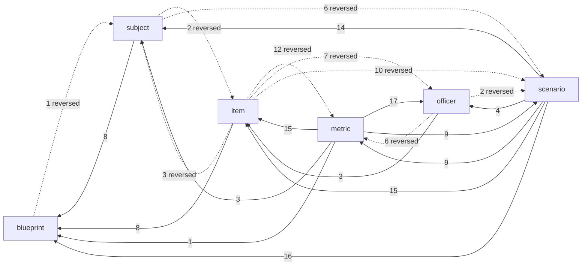

# Architecture

Generated from `src/architecture/` by its tests. Do not edit by hand: change the manifest, then run
`npx vitest run src/architecture -u`. A test fails when the code and this page disagree.

## Layers

A module may import its own layer and the layers it lists. Type-only imports do not count.

| Layer | Modules | Lines | May import | Owns |
| --- | --- | --- | --- | --- |
| kernel | 6 | 2167 | nothing | Shared records, ids, seeded randomness, geometry and the tuning registry. No game rules. |
| world | 47 | 7862 | kernel | Blueprints: authored and procedural buildings, rooms, openings, furniture, routes and sightlines. |
| catalog | 26 | 5096 | kernel, world | Authored data: officers, personas, items, courses, unlocks, call templates and call trees. |
| scenario | 9 | 2141 | kernel, world, catalog | Turns a drawn call into a playable definition: cast, placement on the blueprint, compiled tree. |
| engine | 54 | 12902 | kernel, world, catalog, scenario, commerce | Game rules and state: department, economy, operations, resolution, outcomes, saves. |
| commerce | 4 | 198 | kernel | Point packs and the purchase ledger. |
| qa | 24 | 3698 | kernel, world, catalog, scenario, engine, commerce | Content gates, balance measurement, fixtures and test support. Never loaded by the game. |
| ui | 105 | 15621 | kernel, world, catalog, scenario, engine, commerce | Player screens, the blueprint renderer, portraits and the store that dispatches commands. |
| lab | 97 | 16948 | kernel, world, catalog, scenario, engine, commerce, qa, ui | The dev-only Scenario Lab and dev sheets. Reads everything, never ships. |
| shell | 3 | 372 | kernel, world, catalog, engine, ui, lab | Entry points that choose which app to mount. |

## Systems

| System | Modules | Lines | Job |
| --- | --- | --- | --- |
| blueprint | 78 | 13966 | Where things are: buildings, rooms, doors and windows, furniture, routes, cover and sightlines. |
| subject | 7 | 1499 | Who is on scene: subjects, hostages, victims, bystanders and animals, their holds, weapons, temper and positions. |
| officer | 14 | 2567 | Who the player sends: ratings, traits, stress, injuries, certifications, careers and squads. |
| item | 23 | 3371 | What they carry: the item catalog, ratings and capabilities, inventory, wear, loadouts and resupply. |
| scenario | 46 | 10832 | What happens: call trees, choices, chance per choice, branches, clocks and meters during a call. |
| metric | 15 | 2628 | What it meant: outcome scoring, harm, debriefs, department reputation, money and progression. |
| platform | 192 | 32142 | Everything that serves the systems above: records, randomness, saves, the store, screens and tooling. |

## System dependency chain

Runtime imports between systems (count of module edges). Platform is left out.

Solid edges follow the intended chain (the scenario reads the blueprint, people, officers and items; metrics read what happened). Dotted edges run against it:

- `blueprint -> subject`: story placement in the blueprint layer reads people.
- `item -> metric`: equipment reads department money and levels directly.
- `item -> officer`: equipment checks officer certifications itself.
- `item -> scenario`: equipment rules read scenario actions and runs.
- `item -> subject`: force tools read subjects.
- `officer -> metric`: careers read department progression.
- `officer -> scenario`: officer state reads operation runs.
- `subject -> item`: subject threat rules read carried equipment.
- `subject -> scenario`: subject rules read scenario runs and actions.

## What moves the odds

Each input a system feeds into a choice's chance, and whether the engine actually reads it.
`wiring.test.ts` perturbs the input on every opening choice of every call tree and checks the favorable chance moves (or, for a gap, that it still does not).

| System | Input | Measured | Floor | Evidence |
| --- | --- | --- | --- | --- |
| officer | Officer ratings (every rating of squad A at 95 instead of 60) | 119 of 119 | 100% | `aptitude` weights each rating per task (src/sim/resolution.ts); the task-weight test checks each choice reads only its own ratings |
| officer | Officer strain (squad A at stress 90) | 104 of 104 | 100% | `conditionFraction` takes strain off each rating |
| item | Carried equipment (squad A deploys with nothing) | 3 of 30 | 10% | Equipment bonuses apply only where a choice declares them (src/gen/incident/trees-v13/compile.ts) |
| blueprint | Door and window states (every opening locked) | 16 of 119 | 13% | v13 choices compile with `approach: none`, so routes, entries and openings mostly never reach the roll (src/gen/incident/trees-v13/compile.ts). Raise minShare as entries are wired. |
| subject | The subject's weapon (the reported weapon disproved) | 91 of 111 | 81% | `incidentSubjects` reads armament knowledge into `threatFx` (src/sim/incident-factors.ts). The rescue tree has no armed person on scene, so it never responds. |
| scenario | Time pressure on the call (pressure 95) | 119 of 119 | 100% | Pressure penalty scaled by composure (src/sim/resolution.ts) |

## Jobs and journeys

| Job | Journey | Covered by |
| --- | --- | --- |
| When a call comes in, let me make hard decisions under pressure and live with what follows. | A new department gets a tactical call on a generated building, deploys, decides until the call ends, and closes the debrief | `src/architecture/journeys.test.ts` |
| When a call comes in, let me make hard decisions under pressure and live with what follows. | Different picks at the same point lead to different next decisions | `src/gen/incident/trees-v13/graph.test.ts` |
| When a call comes in, let me make hard decisions under pressure and live with what follows. | The same pick can take more than one branch, by a roll the player was shown the odds of | `src/architecture/journeys.test.ts` |
| Let me build a department whose people and gear visibly change how calls go. | Better ratings, less strain and the right gear raise the chance on the choices they apply to | `src/architecture/wiring.test.ts` |
| Let me build a department whose people and gear visibly change how calls go. | Hire an officer and buy equipment with department money | `src/architecture/journeys.test.ts` |
| After a call, show me why it went the way it did, so the next decision is better. | Every committed decision in the debrief names what helped and what hurt | `src/architecture/journeys.test.ts` |
| When I come back, show me what happened while I was away and what needs me now. | Time away settles once and caps at 24 hours | `src/sim/economy.test.ts` |
| Never lose my campaign. | A campaign mid-call saves and loads to the same state | `src/architecture/journeys.test.ts` |

## Layer debt

Imports that break the layer rules today. Each must shrink to zero.

| Import | Why it exists |
| --- | --- |
| `/src/gen/building/procedural/generate.ts -> /src/sim/spatial-factors.ts` | Routing mixes geometric reachability (world) with traversal and forcing policy: speed, materials, tool effectiveness, keys (engine). Split reachability into the world layer and pass policy in. |
| `/src/gen/incident/instance.ts -> /src/sim/spatial-factors.ts` | coverOnLine is pure geometry kept in the engine module; move it to the world layer. |
| `/src/gen/incident/trees-v13/compile.ts -> /src/sim/spatial-factors.ts` | Same split as generate.ts: routeAlongOpenings carries forcing policy with its geometry. |
| `/src/gen/incident/trees-v13/compile.ts -> /src/sim/story-bindings.ts` | Room and route binding for a call is scenario placement, kept in the engine; move story-bindings to the scenario layer. |
| `/src/gen/incident/trees-v13/compile.ts -> /src/sim/drawn-effects.ts` | Cascade definitions (keys, combos, variants) are the scenario model, mixed with the engine's draw; split definitions from the roll. |
| `/src/gen/incident/trees-v13/graph.ts -> /src/sim/drawn-effects.ts` | Same split: graph reads cascade definitions. |
| `/src/gen/incident/trees-v13/compile.ts -> /src/sim/incidents.ts` | Reward scaling by tier is economy policy reached from the compiler; pass it in or move it to the catalog. |
| `/src/gen/incident/trees-v13/path-key.ts -> /src/sim/meters.ts` | Meter stances are scenario model kept in the engine module. |
| `/src/content/recruits.ts -> /src/sim/career.ts` | Recruit generation reads career tuning from the engine; move CAREER_TUNING to the catalog or kernel. |

Cross-layer runtime imports in total: 591.
