# UI/UX audit and a new direction: Desk and Street

**Status (2026-10-22):** built on `claude/angry-edison-cae68b` (local, not pushed): `ui-system`,
`chrome-contract`, `calls-say-once` and `four-tabs` shipped and left the backlog. The plan was
challenged by Codex before building (see [Challenge](#challenge)). One gap remains: the plan only
listed what to remove, so the shipped screens lost art and icons; `visual-story` in
`docs/backlog.md` puts them back. Results are in [What shipped](#what-shipped). The owner asked for a full audit of
every player-facing screen, a plan, and the plan challenged. Midway they gave full visual control
("Assume complete visual artistic control. Break the approach") and chose a new direction
delivered in phases. The proposed backlog items are at the end; `docs/backlog.md` is unchanged
until the owner approves them.

This builds on [game-ux-direction.md](game-ux-direction.md), [call-presentation.md](call-presentation.md)
and [ops-experience.md](ops-experience.md). Where it reverses one of their decisions, it says so in
[Decisions this reverses](#decisions-this-reverses).

## Recommendation

Stop adding passes screen by screen. The screens are inconsistent because there is no system
under them: no type or spacing scale, two definitions of every button and card, amber on almost
everything, and four layers of chrome fighting for a phone's height. Replace it with one system
in four phases, each of which ships and is checked on its own.

The five changes that matter most, in order:

1. **One chrome contract.** A 44px resource bar and four equal tabs on department screens. Flows
   (a call's brief and deploy, the debrief, a hire) hide the tabs and end in one action bar, with
   written rules for every way out (a Prepare draft survives Back; the debrief settles first). The
   raised Ops button goes, because today it sits on top of the primary button of every flow
   screen (`19-brief`, `21-team-picked`, `26-debrief`).
2. **A live call in focus.** The call's strip replaces the resource bar and a "Step out" control
   replaces the tabs. Stepping out never cancels. This is the leave-and-return control Codex said
   any focus mode needs; Codex's review of this plan adds that it needs a pause of its own, so it
   ships last in its phase, after validation.
3. **Say it once, by field.** Each distinct fact gets one home per screen; facts that only look
   alike (an estimate and its range, stars and completion) both stay. Today funding shows in four
   places and in two units on one screen (`+$10/min` in the bar, `+$620/h` under it), the review
   sheet shows the same 90% three times, and the squad is "Alpha" on Prepare and "Squad A" two
   taps later.
4. **One visual system.** Six type sizes with nothing a player decides from under 14px (today
   rank prefixes on officer tiles render at 8.4px at 390 and 6.7px at 320), one primitive set,
   amber only for the player's move, and red and blue only on a live call.
5. **Four destinations.** HQ, Calls, Officers, Build. Build joins Develop and the Armory, which
   both spend funding to grow the department; the HQ cutaway stops repeating the tabs and shows
   state instead. Basic kit has left inventory (3e000c9), so the Armory now holds only pooled
   specialist gear; the merge still waits for the owner's validation.

## How the audit was done

- **Build:** this branch fast-forwarded to `claude/eager-elgamal-f0ef34` at `bab5dea`, so the
  deploy screen pass (one Auto-equip, squad by name, no Default staging) is included.
- **Walk:** a fresh campaign in an isolated headless Chrome context per width (no saved
  campaign was read or written), played through First Run, every tab, every sheet a fresh
  department can open, and a whole *Going Live* call to the board after it. Restock rules and
  loadout presets are locked in a fresh campaign, so their sheets were not captured.
- **Widths:** 390x844, 320x568 and 430x932.
- **Measurement:** a probe on every captured viewport records tap targets under 44px, text under
  13px, horizontal overflow, the height of each chrome layer, and where the primary button sits.
  Output in [captures/ui-ux-audit/probe.json](captures/ui-ux-audit/probe.json), summarized in
  [probe-summary.txt](captures/ui-ux-audit/probe-summary.txt). The scripts are in
  [captures/ui-ux-audit/tools/](captures/ui-ux-audit/tools/) and rerun with
  `node capture.mjs <repo> <outDir> <baseURL> 390,320,430`.
- **Evidence:** contact sheets per screen in [captures/ui-ux-audit/](captures/ui-ux-audit/)
  (`390/`, `320/`, `430/`), each showing the screen scrolled in steps of 85% of its scroll owner.
  The first run capped each screen at three to six steps, so long screens were sampled, not
  walked to the bottom; Codex caught this. The tool now captures through the bottom of every
  scroll owner (sheets, the debrief, the page) and exits with an error when a step fails. The
  review, debrief and training sheets here come from the corrected rerun. Code references come
  from reading the components.

Not covered: physical phones, 200% text, landscape, the welcome-back sheet (it needs 15 minutes
away), two squads on one call, and states past a first call (promotions, injuries, a full roster).
The probe data for 390 and 320 comes from the corrected rerun, in which every step passed; 430 is
from the first run.

## What the numbers say

| Measure | 390x844 | 320x568 |
| --- | --- | --- |
| Chrome on a flow screen (bar, sticky footer, nav) | Bar 52px, nav 65px, primary button top at 723px | Primary button top at 447px of 568 |
| Brief, height to scroll | 2,534px (3.5 screens) | 2,764px (6.1 screens) |
| Team step after picking a squad | 1,948px | 2,170px |
| Debrief, height to scroll | 1,618px | 1,995px |
| Review sheet, visible body between title and footer | 302px | 124px |
| Item sheet visible body (Develop sheet at 320) | 524px | 281px (295px) |
| Text under 13px, worst screen | Squad, 63 elements, down to 8.4px | Squad, down to 6.7px |
| Tap targets under 44px | Live call only: Cancel 44x32, Full map and Hide map 34px tall, plus the dev face switch | Same |
| Horizontal overflow | None | None |

The 44px floor from [mobile-interactions.md](mobile-interactions.md) holds everywhere except the
live call. Text size has no floor at all, and the 320 phone loses most of its height to chrome:
on the review sheet a player sees 124px of the decision at a time.

## Findings by screen

Each finding names the capture it comes from. File references are to `src/ui/`.

### Global chrome

- **Four layers on flow screens.** Top bar (52px), screen banner or plate, sticky footer, and a
  65px tab bar whose raised Ops button overlaps the footer's primary button
  ([19-brief-390](captures/ui-ux-audit/390/19-brief-390.jpg),
  [21-team-picked-390](captures/ui-ux-audit/390/21-team-picked-390.jpg),
  [26-debrief-390](captures/ui-ux-audit/390/26-debrief-390.jpg)).
- **Top bar stats are icon and number only** (`components/TopBar.tsx`). Income reads
  `+$10/min` while every other screen says per hour.
- **Settings are three taps deep:** the bookmark icon opens Saves, which holds a Settings row,
  and "Color names by role" sits in Saves, not Settings
  ([16-saves-390](captures/ui-ux-audit/390/16-saves-390.jpg)).
- **Toasts cover the call.** "Squads deployed" sat over the live strip in every capture of the
  first decide, review and result beats ([22-decide-1-390](captures/ui-ux-audit/390/22-decide-1-390.jpg),
  [23-review-390](captures/ui-ux-audit/390/23-review-390.jpg)), covering the threat.

### HQ ([02-hq-390](captures/ui-ux-audit/390/02-hq-390.jpg), [02-hq-320](captures/ui-ux-audit/320/02-hq-320.jpg))

- **Job:** see what needs you. **Primary action:** none; every block is equal.
- **Order:** sign and hub cutaway with six room buttons, roster summary, funding card, Command
  Staff (five cards), squad duty (one card per squad), recent debriefs.
- **Repeated:** funding in the bar and the funding card; net rate in the bar (`+$10/min`), the
  card (`+$620/h`) and the Duties room (`+$620/h net`); "Roster, 8 of 8 ready" in the hub and
  "8/8 ready" under it; level and trust in the bar and the sign. (Corrected after review: the
  Watch Commander's per-squad switches are an automation opt-out, `policy.optOut` in
  `components/CommandStaff.tsx:204-221`, not a second duty control. Duty itself is set only here,
  `screens/HQ.tsx:194-197`.)
- **The hub repeats the tabs:** Dispatch is Ops, Roster and Training are Squad, Armory is Gear,
  Planning is Develop. Only Duties is unique, and it scrolls to a block on the same page.
- **Noise before need:** five vacant Command Staff posts at full card height on a new campaign.
- **Small text:** 36 elements under 13px, room captions at 11.5px (`components/hub.css`).

### Squad ([05-squad-390](captures/ui-ux-audit/390/05-squad-390.jpg), [05-squad-320](captures/ui-ux-audit/320/05-squad-320.jpg))

- **Job:** arrange squads, look after the roster, hire, train. **Primary action:** unclear.
- **Order:** banner (about 190px), Roster and Training rail, squad tabs with + and Arrange, the
  squad card, roster grid, then Recruit at the bottom of the same scroll.
- **Repeated:** every Alpha officer appears twice on one screen, in the squad card and again in
  the roster grid below it. "Roster 8/12" appears in the roster heading and the Recruit hint.
  Assignment has three paths (bench, officer sheet, Arrange); leader is set in two.
- **Names:** "A" plus "Alpha" in tabs, "A · Alpha" in Arrange, letters only at 320.
- **Mobile:** four-up tiles carry a rank prefix at 8.4px (6.7px at 320), a name at 10.5px and
  four icon glyphs per tile. 63 text elements under 13px.

### Officer sheet ([06-officer-390](captures/ui-ux-audit/390/06-officer-390.jpg))

- **Repeated:** stress in the readiness block and again in Care; the title says "Jordan Ellis"
  while every tile says "Cpl. Ellis".
- **Footer:** Train, Teach and Dismiss as equal peers, so the destructive action sits beside the
  everyday one. Labels ellipsize at 320 (`officer-profile.css` sets `nowrap` on `.btn`).
- **At 320** the sheet's body is 366px tall under a hero that repeats on every tab.

### Recruit and hire contract ([08-recruit-hire-390](captures/ui-ux-audit/390/08-recruit-hire-390.jpg))

- Each candidate card is about 330px; three fill a phone. Recruit lives at the bottom of the
  Squad scroll instead of having a place of its own.
- Hiring is review, confirm, done (`screens/Recruit.tsx`) while Command Staff hires in one tap.
- The contract shows funding now and after as bars, which the bar already shows.

### Develop ([10-develop-390](captures/ui-ux-audit/390/10-develop-390.jpg), [11-develop-390](captures/ui-ux-audit/390/11-develop-390.jpg))

- **Repeated:** funding and rate under the banner (`$12.4K +$620/h`) beside the bar's
  `$12,404 +$10/min`; the Next up card is also the row marked Next a little below it.
- **Amber everywhere:** four amber Unlock buttons on the first screen; the one recommended
  purchase looks the same as the rest. The buy control is a styled `span`, not a button
  (`screens/Develop.tsx:252`).
- **Branch tabs are icons with counts** (`0/8`, `0/6`) and no words.
- **Names:** the room says Planning, the tab Develop, the banner Build the department.

### Gear ([12-gear-390](captures/ui-ux-audit/390/12-gear-390.jpg), [13-gear-390](captures/ui-ux-audit/390/13-gear-390.jpg))

- **Job:** buy and look after equipment. **Order:** banner, Quartermaster card, three tool
  tiles, collection bar, search, filter rail, sort select, then 27 tiles in a 4-up grid, 2,190px.
- **Amber everywhere:** every buyable tile ends in an amber price tag, nine on the screen.
- **Names:** the tab says Gear, the banner Equipment, the kicker and HQ room Armory, Command Staff
  "Gear maintenance".
- **Since the walk:** radio headset ×8, light protective kit ×8 and service sidearm ×2 showed as
  stock here and as steppers on the team step. Basic kit (3e000c9, after this audit's captures)
  makes a radio, sidearm, carbine and light armor part of every officer: never stock, never sold
  or packed, no bonus. The Armory and team step now say so in one line, the radio row and its buy
  button are gone from Prepare, and HQ's "Radios short" state and the Gear dot are gone. The
  shotgun is the response upgrade, and teams use a less-lethal tool first when a trained officer
  carries one with its supply.
- **Item sheet:** "Purchase unlocked" and the price as chips, then "Unlock and qualifications"
  saying the same in prose; the footer shows the total twice ("Total funding $250", "Buy 1 · $250
  funding"). At 320 the body between header and footer is 281px.

### Saves and settings ([16-saves-390](captures/ui-ux-audit/390/16-saves-390.jpg), [17-settings-390](captures/ui-ux-audit/390/17-settings-390.jpg))

- Each slot carries Load, New here, Save here, Rename and Delete; New game, Save now and Save a
  copy sit above them.
- Settings opens on the 988 support block, then three switches that can't be switched (suicide
  risk, gunfire, injury) with a line saying why. A dead control reads as a broken one.

### Calls board ([18-board-390](captures/ui-ux-audit/390/18-board-390.jpg), [27-board-after-390](captures/ui-ux-audit/390/27-board-after-390.jpg))

- **Order:** "Dispatch / Call-outs" banner with a paragraph, "Live calls" with a slot meter, three
  cards of about 420px, the next-arrival line, the casebook with two filter rails for one entry.
- **Amber on every card** (Prepare), the hostage type mark is still a padlock, and "No penalty
  for skipping this call" repeats on every card. `ops-experience-now` already covers the card;
  this audit adds that the card itself should be the tap target.
- **Names:** Ops, Dispatch, Call-outs, Live calls, Operations.

### Brief ([19-brief-390](captures/ui-ux-audit/390/19-brief-390.jpg), [19-brief-320](captures/ui-ux-audit/320/19-brief-320.jpg))

- Back reads "Operations"; the step tabs and the footer both move between Briefing and Team, so
  there are two controls for one move.
- The orders sit about three screens down at 390 and five at 320 (`ops-experience-now` moves them
  up). The plate and title take about 170px before the tabs.

### Team and gear ([21-team-picked-390](captures/ui-ux-audit/390/21-team-picked-390.jpg))

- After `bab5dea` the squad reads "Alpha" here, and Auto-equip is one button. Still: every pooled
  and worn item is a stepper (eight cards with minus and plus), the map repeats from the brief,
  and the support vehicle block sits below the gear.
- The footer says "Ready · Alpha"; the live call then says "Squad A at High street" and the review
  footer "Acting: Squad A".

### Live call, decide ([22-decide-1-390](captures/ui-ux-audit/390/22-decide-1-390.jpg), [25-decide-2-3-390](captures/ui-ux-audit/390/25-decide-2-3-390.jpg), [22-decide-1-320](captures/ui-ux-audit/320/22-decide-1-320.jpg))

- The top bar steps aside here, which is right, but the tab bar stays and the raised Ops button
  sits on the story text.
- The header's Cancel is 44x32 and the map buttons 34px tall.
- The clock reads "0 min" and the pressure "Low" in two pills above the stage rail, then the
  threat repeats its own minutes below.

### Review sheet ([23-review-390](captures/ui-ux-audit/390/23-review-390.jpg), [23-review-320](captures/ui-ux-audit/320/23-review-320.jpg))

- **Same fact three times:** 90% in the header bar, again in the What could happen bar, again as
  "Goes well 90% chance". The estimate twice ("Estimated time: 4 min" chip, "Est. 4 min" footer);
  the range "4-6 min depending on the result" is a separate fact
  (`sim/operation-selectors.ts:413-437`) and stays. Harm as a chip ("Harm low") and again
  ("Possible harm: low").
- At 320 the visible body is 124px, the map comes first, and the floor tabs fill it.
- The confirm button repeats the whole choice title in capitals.

### Result and debrief ([24-result-390](captures/ui-ux-audit/390/24-result-390.jpg), [26-debrief-390](captures/ui-ux-audit/390/26-debrief-390.jpg))

- The result beat now leads with the story (from the eager-elgamal work), then raw numbers
  ("Pressure +1.2").
- Stars and "Call resolved" are different facts (force and a partial close cap the stars
  separately, `screens/DebriefContents.tsx:44-55`); the CLOSED stamp repeats the completion. The
  screen ends on "Close debrief" with the raised Ops button over it.

## The cross-screen ledgers

### Say it once, by field

Corrected after review. The first version merged facts that only look alike. A removal now names
the field it removes and the field that keeps the fact; distinct fields stay even when they sit
side by side.

| Field | Where it repeats now | Keep once at | Distinct fields that stay |
| --- | --- | --- | --- |
| Funding now | Bar, HQ card, Develop header, hire contract | The bar | Funding after a purchase, on the buy or hire button |
| Net rate now | Bar per minute, HQ card and Duties per hour, Develop per hour | The bar, per hour | Projected rate after a hire (`screens/Recruit.tsx:205-210`), in the contract |
| Level and trust | Bar, HQ sign, Develop header | The bar | Milestone progress on an upgrade |
| Squad readiness | Board chips, pick card, footer, HQ duty cards, HQ chips, Squad pips | The squad's row ("4 of 4 ready") wherever the squad appears | Who is not ready and why |
| An officer | Squad card and roster grid on one screen | Squads view or Roster view, never both at once | |
| A choice's odds | Card bar and text, sheet header bar, forecast bar, forecast row | The card bar; the sheet's three outcome rows | |
| A choice's time estimate | Card, sheet chip, sheet footer | Card meta; the action bar's summary | The outcome-dependent range, in the sheet |
| A choice's harm | Card, sheet chip, forecast chip | Card meta; the action bar's summary | |
| The threat | Board summary, brief, strip | Brief once, the strip during the call | Each choice's own exposure ("Too slow", "Risk", `screens/DecisionList.tsx:30-36`) |
| Completion | "Call resolved" and the CLOSED stamp | "Call resolved" with what is still open | The stars, which force and partial closes cap separately |
| An officer's stress now | Tile, readiness block, Care tab | The readiness line | Stress history and recovery, in Care |

### One name per thing

| Thing | Names in use | Name |
| --- | --- | --- |
| The calls tab and everything in it | Ops, Dispatch, Operations, Call-outs, Live calls, operation, incident | **Calls** (a call, the call) |
| A squad | Squad A, A plus Alpha, A · Alpha, a bare id, Your team | **Alpha**, with the letter badge |
| Equipment | Gear, Armory, Equipment, Gear maintenance | **Armory** (inside Build) |
| Upgrades | Develop, Planning, Build the department, Next up | **Upgrades** (inside Build) |
| People | Squad tab, Roster, The team, officers | **Officers** tab; Squads, Roster, Hire, Training inside |
| Moving through a call | Prepare, Choose team, Deploy, Confirm: X, Continue to X, Close debrief, Return to HQ, Close | Open the call, **Choose team**, **Deploy Alpha**, **Confirm**, **Continue**, **Done** (Done settles the call, then leaves) |
| Buying | Unlock, Upgrade, Save up, Buy tier X, Buy now, Buy 1 · $250 funding | **Buy** with the price; **Free at** for a milestone |

### Patterns in use

| Pattern | Variants found | Converge on |
| --- | --- | --- |
| Screen header | Banner with kicker, title and line (HQ sign, Squad, Develop, Gear, board), plate with case code (Prepare), back link, none (live) | No header on a tab root; a 52px head with back and title on a flow |
| Section heading | `Section`, `squad-block-title`, `h3.pb-h`, `SubHead`, `operation-choice-count`, `drow-h`, mono kickers | One heading: 14px, sentence case, a quiet count or link on the right |
| Buttons | `.btn` in `app.css` and again in `skin.css`, plus `dev-buy-btn`, `recruit-review-toggle`, `armory-tool`, `qm-card`, `hub-room`, `bench-add`, `squad-add-control` | Primary, quiet, small; one primary per screen |
| Chips and pills | `.chip` redefined at 11 to 13.5px per screen, `pill`, `hud-pill`, `threat-pill`, `stamp`, `staff-pill`, `dev-chip` | One chip at 12px, 28px tall, three tones |
| Lists | Card grids, tile grids, bordered cards inside cards | Rows with a hairline; cards only for things you open |
| Detail | Sheets, disclosures, inline expanders, a full-map dialog | Keep the disclosure taxonomy in game-ux-direction.md |
| Footers | Two buttons (Prepare), one (debrief), confirm with a summary (review), none (decide) | One action bar: an optional summary line, one primary, at most one quiet button |
| Empty states | Five wordings and two components | `EmptyState`, one line saying what makes it fill |

## Conventions weighed

Each is a convention of mobile management and idle games. It is listed with why it does or doesn't
fit a game whose main draw is the writing and whose loop is short calls between idle stretches.

| Convention | Verdict | Why for this game |
| --- | --- | --- |
| Persistent resource bar | **Adopt, slimmer** | Funding, rate, trust and level are what every department decision is weighed against. With words ("Trust 78", "Level 1") instead of bare icons, and one unit for the rate. |
| Bottom tab bar, up to five equal tabs | **Adopt, four** | Five tabs exist because Gear and Develop are separate; they are one job (spend to grow). |
| A raised center action | **Reject** | It is a shortcut to a tab the player can already reach, and here it covers the primary button of every flow screen. A count badge on Calls carries the same pull. |
| Tab bar hidden on pushed flows | **Adopt** | The standard iOS and Android behavior for a task with an end. It frees 65px on the screens with the most to read, and back is always top-left. |
| Immersive mode for the core moment | **Needs validation** | The call is the moment the writing has to land. Step out returns to HQ without cancelling, which is what Codex required in the ops review, but it needs a pause of its own (see Challenge). |
| One primary action per screen | **Adopt** | Today amber marks a dozen things per screen, so it no longer says "this one". |
| Badge discipline | **Adopt** | Calls gets a count; other tabs a dot only when there is a move to make now. HQ never badges. |
| Home screen as a hub of rooms | **Adapt** | Keep the cutaway as the picture of the department, drop the rooms as buttons that duplicate tabs. A room speaks only when something in it needs the player. The shift report stays reopenable after the welcome sheet is dismissed (`screens/HQ.tsx:56-67`). |
| Collection grid with a price on every tile | **Reject** | Prices on every tile turn the Armory into a shop and spend the amber. Price stays quiet on the tile; the item sheet buys. |
| Card per entity with art | **Keep, one anatomy** | Art, title, one line, one status mark, one trailing value or chevron. Used for calls, officers, items, upgrades and staff. |
| Progressive disclosure | **Keep** | The taxonomy in game-ux-direction.md stands. This plan only stops facts being shown again on the surface above it. |
| Segmented control for sub-areas of a tab | **Adopt** | Officers (Squads, Roster, Hire, Training) and Build (Upgrades, Armory) replace three screens' worth of stacked sections. |
| Claim buttons, daily rewards, streaks | **Reject (stands)** | Already rejected in game-ux-direction.md; nothing here brings them back. |

## The new direction: Desk and Street

Two registers in one system. The **Desk** is the department: calm, low-chroma, dense but
readable, colour only where the player can act. The **Street** is a call: the scene full bleed,
the story in a reading face, the department chrome gone, red and blue only here. The split
follows the game's own rhythm: long quiet management, then short calls that should feel unlike
everything around them.

Mockups at 390x844 and 320x568, drawn from
[mockups/ui-direction/index.html](mockups/ui-direction/index.html) with the game's art and
*Going Live*'s text as played. Portraits are illustrative.

| | | |
| --- | --- | --- |
| 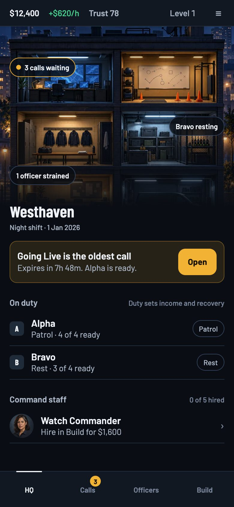 **HQ**: the cutaway shows state; one "your move" card; duty set here only | 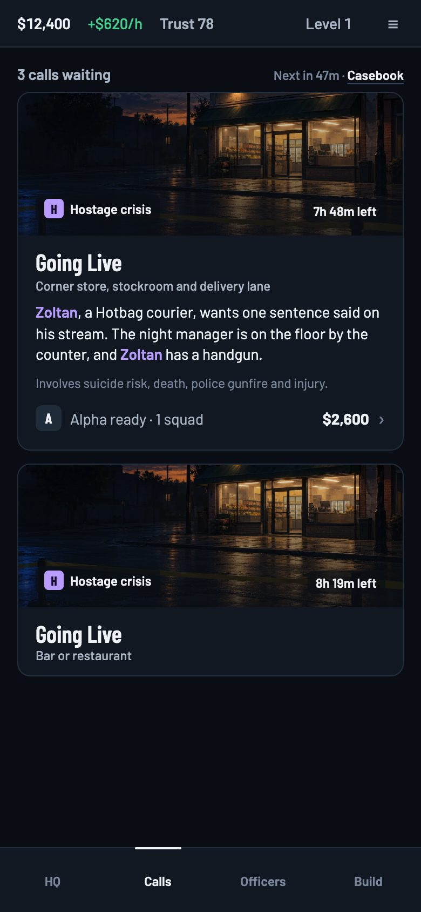 **Calls**: the card is the tap target; one warning line; pay and readiness on one row | 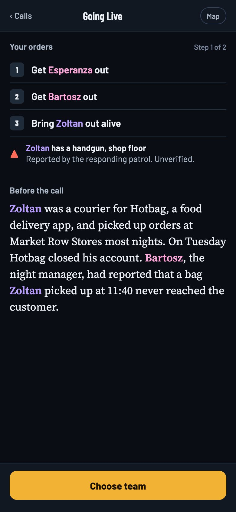 **Brief**: a pushed flow, orders and threat first, cold open whole, Map in the head |
| 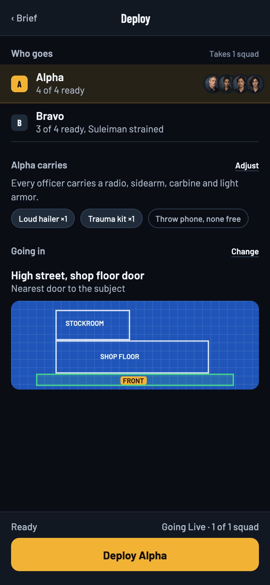 **Deploy**: squad rows, kit as a summary with Adjust, basic kit as one line, "Deploy Alpha" | 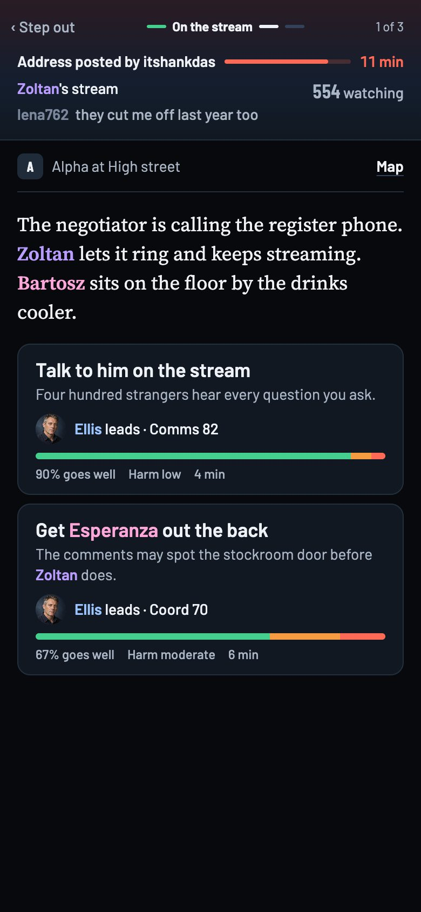 **Decide**: strip and Step out, no tabs; one choice card anatomy | 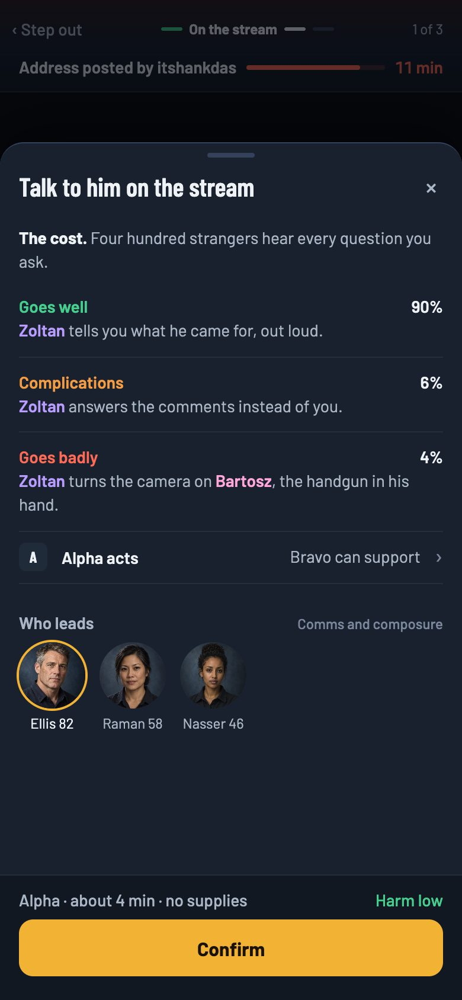 **Review**: cost and the three outcomes first; odds stated once |
| 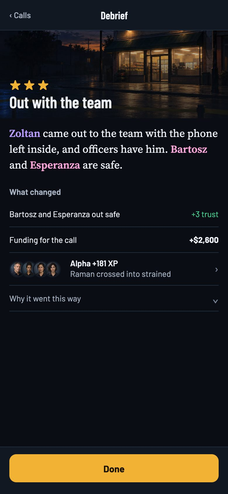 **Debrief**: ending, what changed as rows, Done | 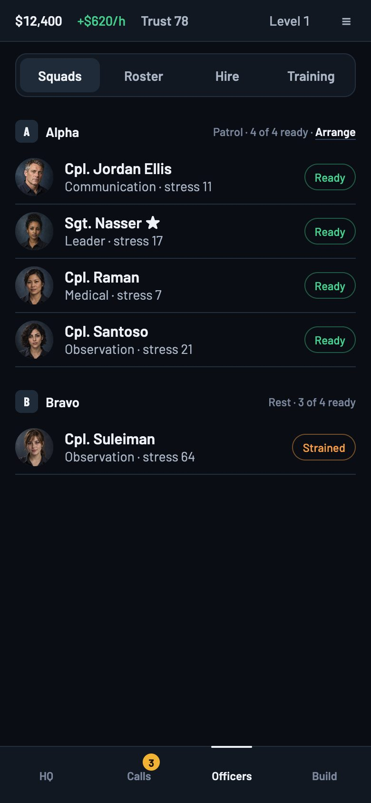 **Officers**: rows that hold at 320, each officer once | 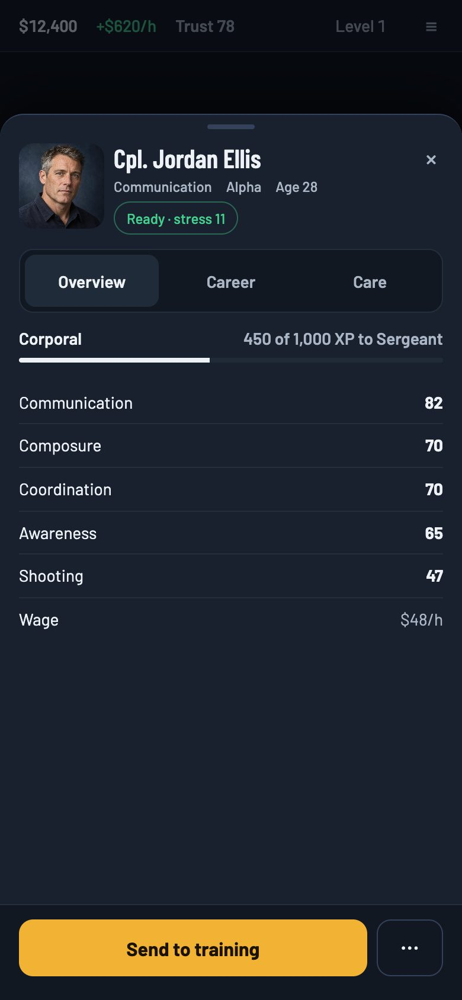 **Officer**: one readiness line, Dismiss moves into the overflow |
| 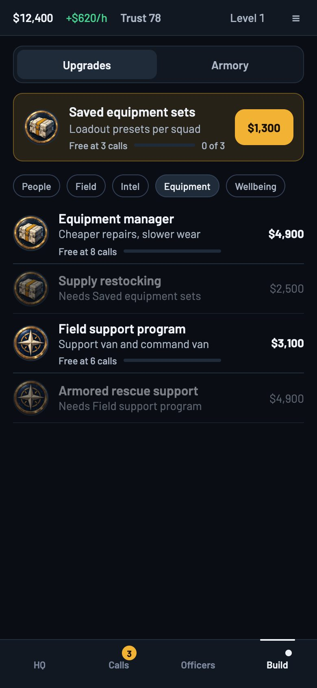 **Build, Upgrades**: amber on the one Next card; branches named | 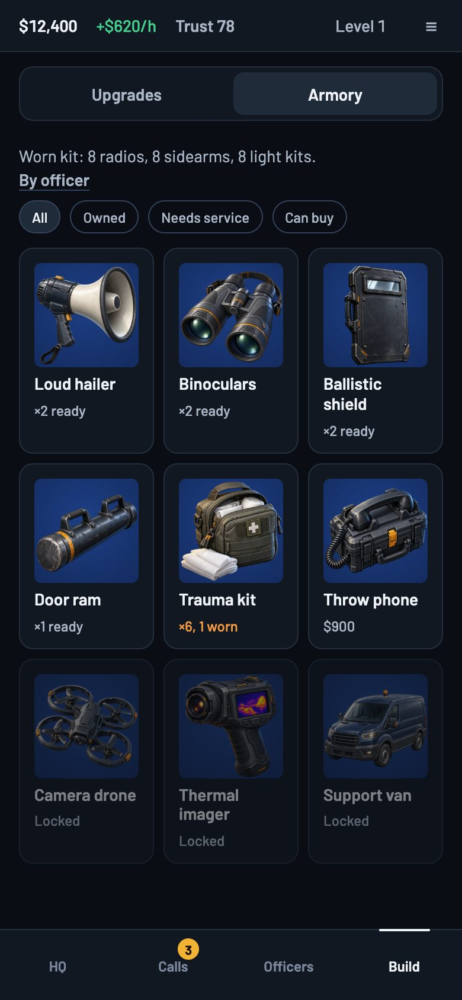 **Build, Armory**: pooled gear only, prices quiet | 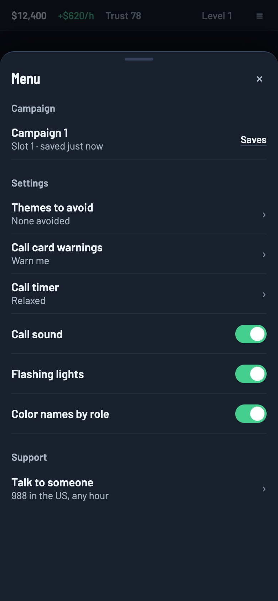 **Menu**: settings, saves and support in one sheet |

The 320 renders are beside them (`*-320.jpg`); none overflows. After review the decide frame
keeps the approved 4B order whole (strip with the source's effect and chat, scene with the squad's
faces, the moment, the radio transcript, the reserved on-scene line, the choices); this plan
changes only the chrome around it. The review frame shows who acts and the supporting squad.
Decision meta and action-bar summaries are 14px and segmented controls 44px, so the reference
meets its own floors. Not yet drawn: two squads on one call, and the 200% text layouts.

### Structure

1. **Four tabs:** HQ, Calls, Officers, Build. Equal width, no raised button. Calls carries a count
   and, during a call, the live ring that already exists.
2. **Chrome contract:** Desk screens have the 44px bar and the tabs and no banner. Flow screens
   (brief, deploy, debrief, hire, any multi-step) have a 52px head with back and title, no tabs,
   and one action bar. The live call has the strip and Step out.
3. **Menu:** one sheet from the bar for the campaign (current slot, Saves), Settings as rows, and
   Support. Settings that can't change aren't shown as switches; the avoid-themes list shows only
   the themes a player can avoid, with one line saying which themes every call can carry.
4. **Officers:** Squads (each squad a block of rows, the leader starred, Arrange on the heading),
   Roster (filter and sort), Hire (candidates as rows with the contract in a sheet), Training.
5. **Build:** Upgrades (one Next card, named branch chips, rows with quiet prices and milestone
   progress) and Armory (pooled gear grid, basic kit as one line).
6. **HQ:** the cutaway with pins only for state that needs the player, one card for the most
   pressing move, duty rows (where duty is set by hand, with each squad's Watch Commander opt-out
   and its status on the same row), Command Staff as rows, recent results.

### Skin

- **Type.** Barlow for the interface, Barlow Condensed for titles in sentence case, Source Serif 4
  for story text (cold open, prompt, result, ending). Oswald and IBM Plex Mono leave the
  interface; Kalam stays on the blueprint. The serif is the open `owner-visual-picks` item;
  this plan recommends it, the owner still judges it at 320 and 200% text, and phase 1 does not
  ship it: story text keeps Barlow until that compare is settled.
- **Scale.** 12 (meta only), 14 (body), 16 (row titles, buttons), 18 (story, choice titles), 22
  (card and sheet titles), 28 (screen hero). No decision text under 14.
- **Space and shape.** 4, 8, 12, 16, 24, 32. Radius 6, 12, 20 (sheets).
- **Colour roles.** Amber is the player's move, once per screen. Mint is a good result, red is
  harm, warn orange is strain and wear. Red and blue sweep only on a live call. Blueprint blue is
  the map. Everything else is slate. Named people keep their role colours.
- **Surfaces.** Flat panels, rows with hairlines, a card only for a thing you open, elevation only
  for sheets. Identity comes from portraits, gear art and scene plates, not borders and kickers.

## Decisions this reverses

| Decision | Recorded | Why it changes |
| --- | --- | --- |
| HQ as a hub whose rooms are labeled buttons | game-ux-direction.md, night-shift skin, 2026-10-19 | Five of six rooms duplicate tabs. The art stays; the rooms become status. |
| Ops as the raised center action | Same pass | It overlaps the action bar on every flow screen (captured), and a badge carries the pull. |
| A banner plate per tab | Same pass | About 120 to 190px per tab root for a title the tab already names. The plates move into content (call cards, the debrief hero). |
| Operation mode rejected | ops-experience.md, Codex review | Re-proposed only with the control Codex asked for: Step out, separate from cancel, the call resumable from the Calls ring. |
| Recruit inside the Squad scroll | department pass, 2026-10-19 | Becomes the Hire segment of Officers. |

## The phases

Ranked by player impact for the effort. Each phase ships alone and leaves the game consistent.

| Phase | What ships | Player impact | Effort | Waits on |
| --- | --- | --- | --- | --- |
| 1. One visual system | Tokens for type, space and colour roles; one primitive set (Button, Chip, Card, Row, Sheet, ActionBar); the duplicate definitions in `app.css` and `skin.css` deleted; hex moved to tokens; the new skin through the tokens, without the story serif; ratchet tests | High (every screen reads cleaner, small text gone) | Medium | nothing |
| 2. Chrome contract | Resource bar; no banners on tab roots; flows with a head and one action bar and no tabs, with the exit table below; Menu sheet; toasts never over the strip. Step out only after its pause is built and validated | High | Medium | Phase 1 |
| 3. Calls flow | Say-it-once by field and the verb ladder on the board, brief, deploy, decide, review, result and debrief, designed against today's pooled equipment; folds in `ops-experience-now` | High | Medium | Phase 2 |
| 4. Four destinations | Officers and Build tabs; HQ as status; one assignment path; one preset home (`squad-preset-editor`); badge-to-segment routing | High | High | Phase 2, basic kit (landed), owner validation |

**Exits from a flow** (required before phase 2 hides the tabs; corrected after review, which found
that Prepare's draft is component state that Back discards, `screens/OpsPrepare.tsx:73-90` and
`screens/Ops.tsx:24`):

| Exit | Today | Required |
| --- | --- | --- |
| Back from the brief or deploy step | Clears `prep` and unmounts the draft | The draft (squads, kit, staging) lives outside the component and survives Back, browser Back and Forward, and a detour to buy, train or unlock |
| A detour to another tab mid-Prepare | Draft lost | Same draft on return; the Calls tab returns to the step the player left |
| Leaving the debrief | "Close debrief" settles: pays, awards XP, releases assignments (`sim/operation.ts:1314-1354`) | The debrief has no Back. Done settles first and then navigates; a tab change or browser Back from the debrief settles the same way or returns to it unsettled, never skips settlement |
| Leaving the live call | Tab change unmounts `OpsLive`; visibility pauses the decision | Step out, with its own pause (below) |
| Keyboard | Focus moves with sheets | Focus lands on the head's title after each push and returns to the trigger after Back |

**Every phase is verified the same way:** captures retaken from the game at 390x844, 320x568 and
430x932 with the probe in `tools/` (which walks every scroll owner to the bottom and fails on a
missed step), compared with this audit's numbers; `npm run test:e2e` at 390 and 320; 200% text,
keeping the strip's short-screen escape (below 520px of height it scrolls with the page); two
squads deployed where a call takes two; reduced motion; the Scenario Lab renders the shared Ops
pieces (`CallTile`, `PrepBriefing`, `LiveView`, `ActionSheet`, `DebriefContents`); the return from
idle (welcome back, an empty board); `npm run verify`. Phase-specific checks:

1. No text under 14px that a decision reads from (odds, harm, time, lead values, the action bar's
   summary), no interactive element under 44px, no hex outside the theme file. Each is a test whose
   floor only rises, like the architecture floors.
2. The primary button's top at 390x844 is the action bar's, never covered; the review sheet's
   visible body at 320x568 is at least twice today's 124px; every row of the exit table passes.
   Step out ships only with a pause owned by navigation, separate from page visibility:
   `store.ts:66-70` resumes any paused decision when the page becomes visible, so today Step out,
   then backgrounding and returning on HQ, would restart the call's clock. Tests: background and
   reload while stepped out, wait past the threat window, resume without losing elapsed time, and
   department accrual keeps running.
3. For every field in the ledger, the field that keeps it is present and the repeats are gone; the
   distinct fields (time range, per-choice exposure, completion, projected income) are present.
   Checked against the shared components in the game and the Lab, not by counting strings.
4. The `hire-and-equip` and `answer-a-call` journeys pass; the e2e script reaches every former
   screen through the new tabs; the round trips in `components/nav.tsx:68-78` (item to training to
   upgrade and back to the item) still return; a badge opens the segment it is about.

## Challenge

### My own strongest case against each change (before review)

- **Four tabs.** Merging Develop and the Armory buries the Armory one tap deeper, and the radio
  shortage dot would move to Build. Basic kit removed the radio shortage, so that dot is gone.
- **Hiding the tabs on flows.** A player mid-brief who wants to check an officer has to back out.
  I first wrote that Prepare already keeps its draft. It doesn't; see the exit table.
- **Step out.** A call left running in the background is a call the player forgets; with the
  timer on, the threat lands while they browse. Control: its own pause, and the Calls ring and
  HQ's top card say a call waits.
- **No raised button.** The center action is the most recognised management-game shape and it
  pulls players into calls. Control: the count badge and the HQ "your move" card; measure calls
  taken per session in playtests before and after.
- **Story serif.** A serif wraps longer and pushes the first choice down at 200% text; that is why
  it is still an owner compare.
- **Rows instead of portrait tiles for officers.** People are the game's faces, and rows shrink
  them. Control: 40px faces in rows, 72px in the sheet, and the squad block shows all four at once.
- **Say it once.** Removing the funding line from a purchase sheet makes the player look up to
  check. Control: the buy button carries the after-amount.

### Codex adversarial review (against sol)

Run on Codex's configured default model (`gpt-6.1-sol`) with
`codex-companion.mjs adversarial-review --wait --base bab5dea --scope branch`, against commit
`001e35b`, asked to test the plan's claims against `src/ui/` and the earlier decision docs.
Overall verdict: **needs attention**. "Do not adopt this plan as the implementation contract yet.
Reducing chrome is defensible, but the removal ledger conflates distinct mechanics, navigation
lacks state-transition rules, and the mockups do not preserve the approved live-call experience."

| # | Finding (severity) | Checked | Verdict | What changed |
| --- | --- | --- | --- | --- |
| 1 | The say-it-once ledger merges distinct facts: the time estimate and its range, per-choice threat exposure, stars and completion, projected income after a hire (high) | Yes, in `operation-selectors.ts`, `DecisionList.tsx:30-36`, `DebriefContents.tsx:44-55` | Accepted | Ledger rewritten by field, with a column for the distinct fields that stay; findings for the review sheet and debrief corrected; phase 3's check no longer counts strings |
| 2 | Step out can't reuse the visibility pause: `store.ts:66-70` resumes any pause when the page is visible (high) | Yes | Accepted | Step out needs a pause owned by navigation, with tests for background, reload and a long wait; its verdict moves to needs validation and it ships last in phase 2 |
| 3 | Hiding the tabs needs exit rules: Prepare's draft is local and Back discards it; a Back on the debrief would skip settlement (high) | Yes, `OpsPrepare.tsx:73-90`, `Ops.tsx:24`, `operation.ts:1314-1354` | Accepted | Exit table added as a phase 2 requirement; the debrief mockup loses its Back; my false claim about the draft is struck |
| 4 | The live-call mockup drops parts of the approved 4B order (faces, transcript, on-scene line, the source's effect) and the review mockup has no acting or support squad (high) | Yes, against ops-experience.md "The decide beat" | Accepted | Decide and review frames redrawn with the whole payload; 4B stays the live layout and this plan changes only its chrome. Two squads still undrawn, listed as a gap |
| 5 | The Watch Commander's per-squad switch is an automation opt-out, not a duty control (medium) | Yes, `CommandStaff.tsx:204-221`, `command-staff.ts:293-296` | Accepted | HQ finding corrected; the duty row keeps the opt-out and its status |
| 6 | The mockups break their own floors: 12px odds, harm and time; 36px segmented controls (medium) | Yes | Accepted | Decision meta and action-bar summaries at 14px, segments at 44px, mockups rerendered |
| 7 | The capture tool sampled long screens instead of walking them, missed the debrief's scroll owner, and swallowed step errors (medium) | Yes, `tools/capture.mjs` | Accepted | Tool walks every scroll owner to the bottom and exits 2 on a failed step; coverage claims corrected; review and debrief recaptured |

Codex's verdicts on each major change, as recorded:

| Change | Verdict | Control or open question |
| --- | --- | --- |
| Four tabs (Build merges Develop and Gear) | Needs validation | The Armory is still maintenance after `worn-kit` (daily wear survives); define badge-to-segment routing; keep the item, training, upgrade round trips |
| Hiding the tabs on flows | Accepted with controls | The exit table; keyboard focus; browser Back and Forward |
| Live call focus with Step out | Needs validation | Pause ownership; the whole two-squad experience in the game and the Lab |
| Removing the raised Ops button | Accepted with controls | The overlap is real; a badge's pull is unproven. Keep the unread-debrief signal and its reduced-motion form (`BottomNav.tsx:47-50`) |
| HQ rooms as status | Accepted with controls | Keep the automation opt-out and reopening a dismissed shift report; test return from idle and an empty board |
| Say-it-once removals | Rejected as first written | Replaced by the ledger by field |
| Officer rows | Accepted with controls | Keep the qualifications, promotion progress and kit warnings the tiles carry (`OfficerCard.tsx:55-84`); a full roster with long names at 200% text |
| Type scale and colour roles | Needs validation | Mockup sizes fixed; the serif compare first; keep non-colour identity cues (names keep their marks), keyboard access and reduced motion |
| Phase order | Needs validation | Phase 1 without the serif; phase 3 designed against pooled equipment, `worn-kit` folded in after; shared Lab surfaces and the idle return checked at each phase |

## Proposed backlog items

Added to `docs/backlog.md` under Player experience on 2026-10-21, with the owner's approval. Format per `COORDINATION.md`.

```
### ui-system: One visual system under every screen
Tags: job=command; journeys=answer-a-call, hire-and-equip; probes=none (layout and type); lane=interface
Needs: start=none; integrate=none; ship=none

Tokens for type (12/14/16/18/22/28), space (4 to 32) and colour roles, one primitive set (Button,
Chip, Card, Row, Sheet, ActionBar), the duplicate definitions in app.css and skin.css removed,
hex moved to tokens, and the Desk and Street skin applied through them, story text staying in
Barlow until owner-visual-picks is settled (docs/ui-ux-audit.md). Done: tests fail on new
decision text under 14px, interactive elements under 44px and hex outside the theme; captures
retaken at 390, 320 and 430 with the audit's tool, compared with its probe numbers.

### chrome-contract: One chrome contract for desk screens, flows and the live call
Tags: job=command; journeys=answer-a-call, save-round-trip; probes=none (layout); lane=interface
Needs: start=ui-system; integrate=none; ship=none

A 44px resource bar in words and per-hour rates; no banner on tab roots; flows with a head, back
and one action bar and no tabs; one Menu sheet for the campaign, settings and support. Every row
of the audit's exit table holds: the Prepare draft survives Back and detours, the debrief settles
before it is left. Step out comes last, with a pause owned by navigation and not by page
visibility. Done: no primary button is covered at any width; the review body at 320x568 is at
least 248px; background, reload and a long wait while stepped out resume the same beat with
elapsed time kept.

### calls-say-once: Each fact once on every step of a call
Tags: job=command; journeys=answer-a-call, debrief-explains; probes=none (layout); lane=interface
Needs: start=chrome-contract; integrate=none; ship=none

The say-it-once ledger by field and the verb ladder in docs/ui-ux-audit.md applied to the board,
brief, deploy, decide, review, result and debrief, with the squad named one way, designed against
today's pooled equipment. Folds in ops-experience-now, which is deleted when this ships. Done: for
every ledger field the keeping field is present and the repeats are gone, and the distinct fields
(time range, per-choice exposure, completion, projected income) are present, in the game and the
Lab, with two squads on a call.

### four-tabs: HQ, Calls, Officers and Build
Tags: job=build; journeys=hire-and-equip, officer-promotes; probes=none (navigation); lane=interface
Needs: start=chrome-contract (after basic kit reaches main and the owner validates the merge); integrate=none; ship=squad-preset-editor

Officers holds Squads, Roster, Hire and Training; Build holds Upgrades and the Armory; HQ's
cutaway shows state and stops repeating the tabs, keeping the Watch Commander opt-out on each duty
row and the shift report reopenable; assignment has one path; badges open the segment they are
about. Done: the e2e script reaches every former screen; hire-and-equip passes; the nav round
trips return; captures at three widths.
```

## What shipped

Measured with `tools/capture.mjs` at 390x844 / 320x568 by the sessions that built each phase.

| Measure | Audit | Shipped |
| --- | --- | --- |
| Smallest text anywhere | 8.4px / 6.7px | 12px at every width |
| Live-call targets under 44px | 4 to 5 per screen | 0 |
| Top bar / tab bar | 52 / 65px | 44 / 60px; none on flows, none on the live call |
| HQ height to scroll | 1,780 / 1,692px | 1,065px |
| Squad, now Officers, height | 1,939 / 2,082px | 1,001 / 1,018px |
| Brief height | 2,534 / 2,764px | 1,924 / 2,251px |
| Deploy step with a squad | 1,948 / 2,170px | 1,006 / 1,068px |
| Review sheet body at 320x568 | 124px | 273px |
| Settings depth | three taps | one |

What it cost: icon uses in `src/ui/` fell from 269 to 228 and plates from 9 to 4, and the icon kit
is used once. The ratchets guard floors (text size, touch size, hex) and nothing guards the art,
so `visual-story` adds a ratchet that only rises. Left for later: `ui-leftovers` and
`roster-save-rule` in the backlog.

## Notes on basic kit and `worn-kit`

Basic kit landed in 3e000c9: every officer carries a radio, sidearm, carbine and light armor,
which is never stock, never sold or packed, and adds no bonus. The team step and the Armory are
drawn against that: one line saying what every officer carries, pooled specialist gear as the only
stock and the only steppers. `worn-kit` is now only armor reducing harm to the officer wearing it,
which doesn't change these screens. Codex noted the Armory still carries maintenance (daily wear
survives on pooled gear), so Build keeps service and restock. Phase 3 is designed against today's
pooled equipment; phase 4 waits only for the owner's validation of the merge.
